# Refonte UI — SOL Mobile

Branche `feat/refonte-ui`, partie de `dev`, un commit par étape.
Captures prises dans l'aperçu web, à 360 px de large, texte « Grande », thème sombre sauf mention.

## 1. Cohérence des données (priorité 1) — `a3a0b9b`

| Problème | Cause | Correction |
|---|---|---|
| Accueil « Encaissé 0 HTG », « À jour 0/11 » alors que l'Historique montre des cotisations | Les deux chiffres ne comptent que **le jour même**, sans le dire | « Encaissé aujourd'hui » + total du cycle ; « En retard » avec le montant dû ; un seul calcul `summarizeCycleDay` (Accueil, Encaisser, clôture, rapports) |
| « Tour 1 sur 14 » qui n'avance pas | Le tour = remises faites + 1 | Le tour suit le calendrier (`roundOnDate`) ; les remises en retard sont signalées à part (`payoutsBehind`) |
| Retard en « tours » ou en « mains » selon l'écran | Badge en tours, Accueil en mains | Partout en **mains dues + montant en HTG** (`memberOwedHands`, `owedAmount`) |
| Réglages > Devise affiche « 1 250 HTG » | `formatCurrency(1250)` en dur | Affiche la devise choisie (« HTG ») |

Tests ajoutés :
- `test_schedule` : tour par date, Mer/Sam, avant/après le cycle, remises en attente, tours déjà dus ;
- `test_member_rules` : mains dues, montant dû, résumé du jour.

## 2. Système de design — `6950aac`, `3fd5f4c`

- Couleur d'action : **bleu roi**, `#1D4ED8` en clair et `#2F5FF5` en sombre. Je l'ai foncé un peu par rapport au `#3B6BFF` proposé pour que le texte blanc reste lisible : contraste de 5,2:1.
- Statuts :
  - vert = à jour ;
  - orange = en retard ;
  - « À encaisser » neutre (gris) ;
  - rouge réservé aux erreurs et aux actions destructrices.
- Ils s'affichent en petit point + libellé, jamais sur une ligne entière.
- Fond d'écran plus foncé que les cartes, en clair comme en sombre.
- Nouveaux composants :
  - `ScreenHeader` ;
  - `MemberRow` (rang, nom, point de statut, montant, action) ;
  - `Logo` ;
  - apparence `dot` du badge de statut.
- Les autres composants existaient déjà : Button, Card, StatusBadge, EmptyState, SegmentedControl.
- Logo (trois flèches autour de la cagnotte) dans l'app et en icône : icône, icône adaptative Android, splash et favicon. Il remplace l'icône Expo par défaut.
- Plus aucun texte coupé par « … » : les libellés passent à la ligne, les montants réduisent leur taille.

## 3. Écrans

| Écran | Avant | Après |
|---|---|---|
| Accueil | 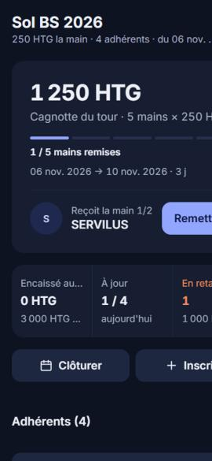 | 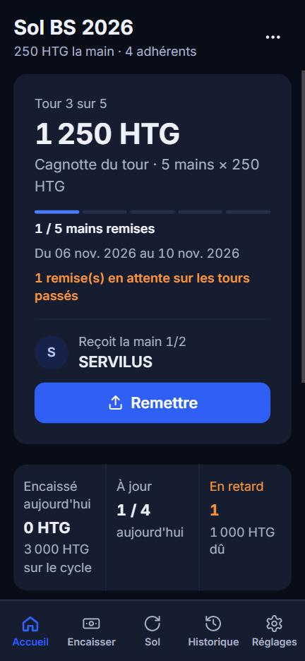 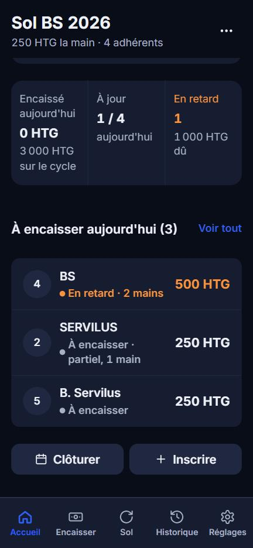 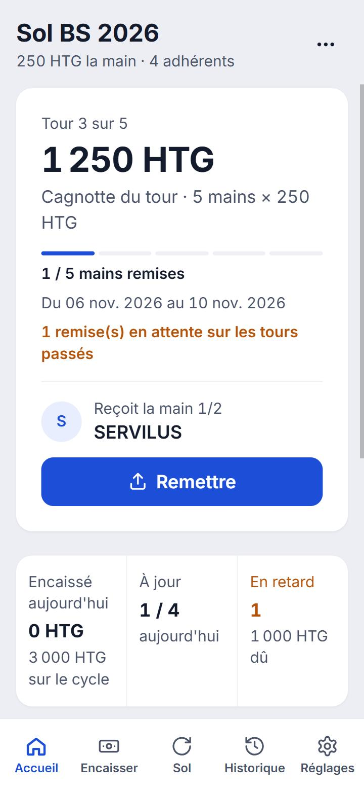 |
| Encaisser | 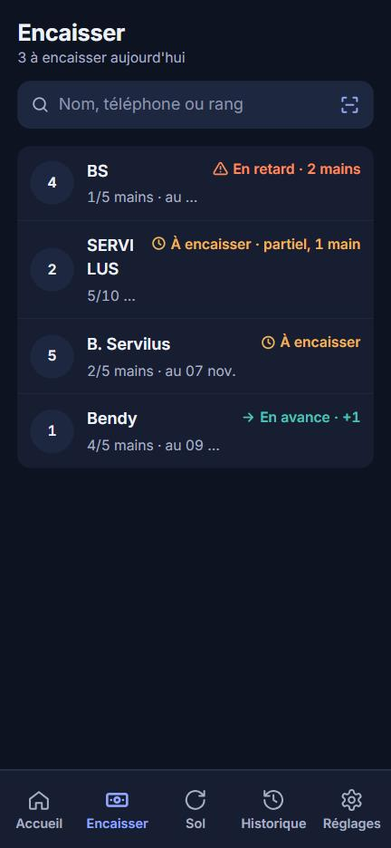 | 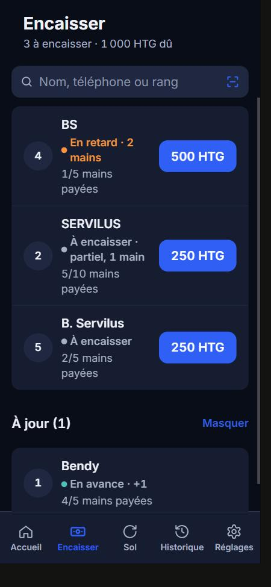 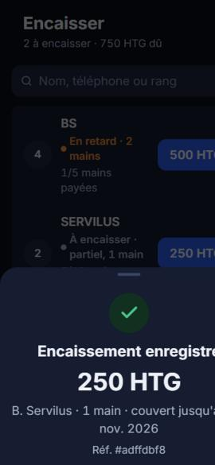 |
| Sol | 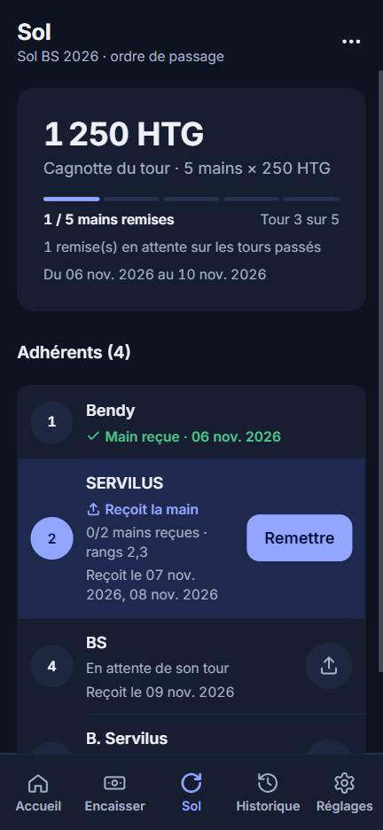 | 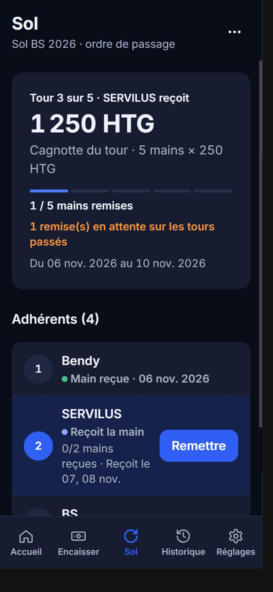 |
| Historique | 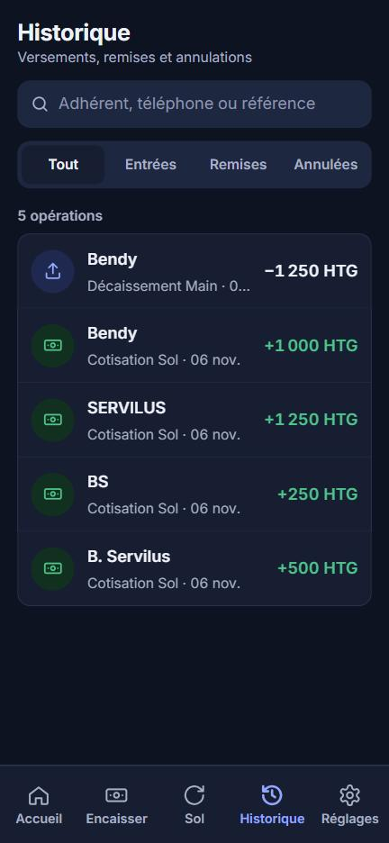 | 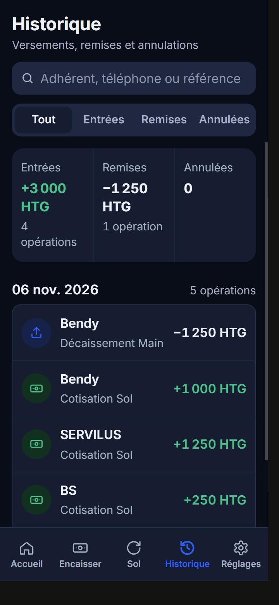 |
| Nouvel adhérent | 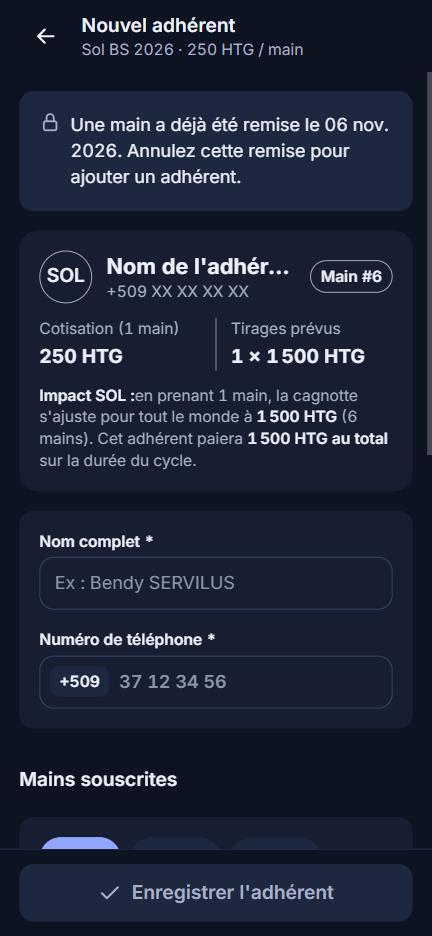 | 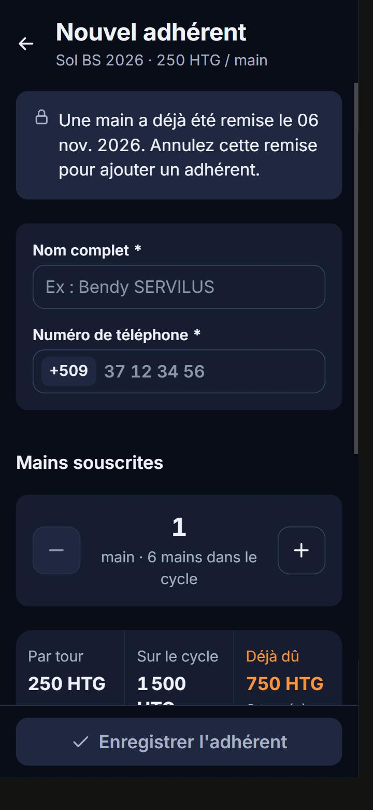 |
| Réglages | 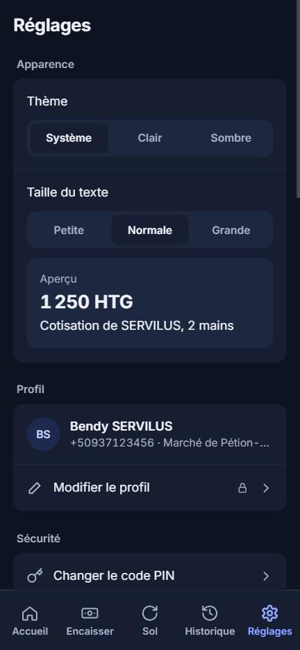 | 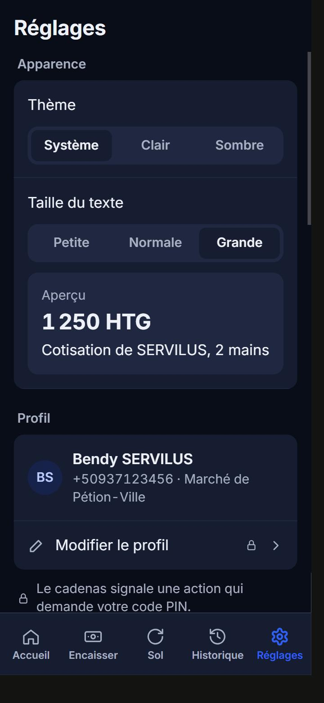 |

**Accueil**
- Carte cagnotte : tour du jour, dates, remises en attente, gros bouton Remettre.
- Résumé : encaissé du jour et du cycle, à jour, en retard avec le montant dû.
- « À encaisser aujourd'hui » : 4 lignes, puis « Voir tout ».

**Encaisser**
- Chaque ligne porte un bouton avec le montant dû : un toucher, le PIN, et c'est encaissé.
- « Annuler cet encaissement » juste après passe par une écriture d'annulation et le PIN.
- Les adhérents à jour sont regroupés en bas et repliés.

**Sol**
- La carte s'ouvre sur « Tour N sur M · X reçoit ».
- Plus d'icône répétée sur chaque ligne : toucher une ligne ouvre la fiche, qui garde la remise hors tour.
- Les dates sont compactes (« 07, 08 nov. »).
- Le menu « … » donne accès aux paramètres, aux clôtures et aux cycles.

**Historique**
- Les opérations sont groupées : Aujourd'hui, Hier, puis la date.
- Une bande de totaux suit le filtre actif.
- Les annulations sont grises et barrées.

**Nouvel adhérent**
- Un seul sélecteur − / + pour les mains.
- Trois chiffres : par tour, sur le cycle, déjà dû.
- La ligne « Encaisser sa part » est entièrement touchable et dit « Oui… » ou « Non… ».

**Réglages**
- Langue en sélecteur Français / Kreyòl.
- Une légende explique le cadenas.
- « Verrouiller l'app » (c'est bien son effet : les données restent, le PIN est redemandé).
- Les réglages du sol sont déplacés dans l'onglet Sol.

## 4. Pas fait, ou décisions à prendre

1. **Le PIN reste demandé à chaque encaissement.** Le « un toucher » ouvre directement le PIN. Le supprimer pour les petits montants est une décision de sécurité qui te revient.
2. **La liste complète de l'Accueil a disparu**, avec ses filtres (À jour, En retard, Main reçue…), son tri et sa recherche. Encaisser a la recherche, Sol l'ordre et les remises. Dis-moi s'il faut remettre un filtre quelque part.
3. **Annulation rapide.** Le motif est rempli automatiquement : « Annulé juste après l'encaissement ».
4. **Kreyòl.** Les 38 nouvelles phrases ont été traduites par moi. Une relecture par un locuteur serait utile.
5. **Pas testé sur un vrai téléphone.** Les captures viennent de l'aperçu web, et l'icône et le splash ne se voient qu'après un nouvel APK. Certaines captures n'ont pas pu être prises : le bas de « Nouvel adhérent » (le bouton a été vérifié par le code de la page) et Sol / Historique en clair.
6. **Écrans secondaires** (Clôture, Cycles, Remise, Diagnostic, fiche adhérent) :
   - ils profitent des nouvelles couleurs et de la fin des « … » ;
   - ils n'ont pas été refaits ;
   - ils utilisent encore l'ancien en-tête `components/Header.tsx`.
7. **Base web de démo.** Pendant les tests, l'encaissement et l'annulation faits dans l'aperçu ont disparu après un rechargement. Je n'ai pas cherché la cause : seul l'aperçu web est concerné, pas l'APK.
